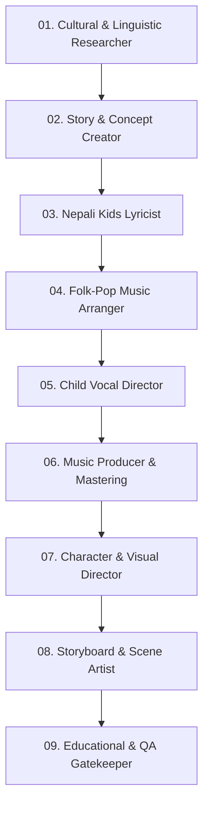

# Child-Friendly Nepali Rhyme Creator Framework
## (नेपाली बालगीत तथा बाल कविता निर्माण निर्देशिका)

This framework guides the end-to-end creation of authentic, joyful, educational, and culturally grounded Nepali nursery rhymes, songs, and animated stories for **Nepali Rhyme Hub**.

---

## The 9 Specialist AI Workflow for Nepali Rhymes

---

### Step 01: Nepali Cultural & Linguistic Researcher
* **Focus**: Authenticity of traditional Nepali rhymes, folklore, nature, animals, and geography.
* **Checks**:
  - Accurate representation of Nepali flora/fauna (Lali Gurans, Danphe, Munal, Kasturi Mriga, Gaai/Goru).
  - Cultural accuracy: Festivals (Dashain, Tihar, Chhath, Maghe Sankranti, Teej), instruments (Madal, Bansuri, Sarangi), and traditional attire (Dhaka topi, gunyo cholo, daura suruwal).
  - No stereotypes, harsh historical depictions, or scary folklore elements (no frightening demon/ghost scares).

---

### Step 02: Children's Story & Concept Creator
* **Focus**: Transforming everyday childhood moments and simple folk tales into interactive 2-3 minute musical journeys.
* **Core Themes**:
  1. **Animal Friends (जनावर साथीहरू)**: कुखुरी काँ, बिरालोको म्याउँ, चरीको चिरबिर, बाँदरको चकचक, हात्ती दाइको सुँढ।
  2. **Daily Habits & Hygiene (राम्रा बानीहरू)**: दाँत माझ्ने, हात धुने, सफा बन्ने, सबेरै उठ्ने, आमा-बुबालाई प्रणाम।
  3. **Learning & Discovery (सिक्ने र बुझ्ने)**: १ २ ३ गन्ती गीत, क ख ग वर्णमाला, सात बार, बाह्र महिना, इन्द्रेणीका रङ।
  4. **Nature & Seasons (प्रकृति र ऋतु)**: पानी पर्यो असिना झर्यो, घाम पानी घाम पानी, हरियाली डाँडाकाँडा, फूल फुल्ने वसन्त।
  5. **Festivals & Joy (चाडपर्व र उमङ्ग)**: दसैँ आयो पिङ खेल्ने, तिहारको झिलिमिली दियो, देउसी-भैलो।

---

### Step 03: Nepali Kids Lyricist
* **Focus**: Writing rhythmic, playful, easily memorized lyrics in pure Devanagari Nepali.
* **Rules**:
  - **Hook within 10–15 Seconds**: The primary musical hook must appear immediately.
  - **Syllable Pace**: 4.0 to 5.5 characters per second (slow and clear enough for toddlers to repeat).
  - **Evolving Responses**: The lead singer's call remains stable, but the children's choir answers evolve across Verse 1, Verse 2, and Final Chorus.
  - **Rhyming & Phonetics**: Natural rhyming couplets (*काँ - घाँस, म्याउँ - गाउँ, पानी - नानी*).
  - **Clean Formatting**: Section headers: `[Intro]`, `[Chorus 1]`, `[Verse 1]`, `[Chorus 2]`, `[Verse 2]`, `[Bridge]`, `[Final Chorus]`, `[Outro]`.

---

### Step 04: Folk-Pop Music Arranger
* **Instrumentation Guide**:
  - **Madal**: The rhythmic heartbeat with clear *thekka* (धिन-ताक-धिन-ता).
  - **Bansuri**: Expressive, cheerful melodies reminiscent of Nepal's mountain breezes.
  - **Sarangi**: Bouncy folk fiddle runs that children love mimicking.
  - **Glockenspiel / Xylophone**: Sparkling kids-pop layer for brightness.
  - **Acoustic Guitar**: Steady rhythmic strumming.
* **Rhythm**: Keherwa (4/4) or Jhyaure (6/8) at **100–125 BPM**.

---

### Step 05: Child Vocal Director
* **Lead Voice**: Gentle, enthusiastic, clear enunciation (reminiscent of a warm kindergarten teacher).
* **Chorus**: Group of young Nepali children ("नानी-बाबु समूह") laughing, cheering, and singing back.
* **Action Cues**: Vocal prompts embedded in the song (*"सबैले ताली बजाऔँ!", "एक, दुई, तीन... उफ्रिऔँ!"*).

---

### Step 06: Kids Music Producer & Mastering Engineer
* **Loudness**: **-14 LUFS (±1.0 LUFS)**.
* **True Peak**: Max **-1.0 dBTP** (clean, zero digital clipping).
* **Frequencies**: Warm low-end without boomy bass; gentle high-end roll-off around 16 kHz to prevent harshness in toddler headphones.

---

### Step 07: Character & Visual Art Director
* **Lead Anchors**:
  - **Aarav (आरभ)**: A curious, joyful 4-year-old Nepali boy with a Dhaka topi and bright smile.
  - **Aarya (आर्या)**: A cheerful 4-year-old Nepali girl with two braided ribbons and gunyo cholo.
  - **Puntu (पुन्टु)**: A cute, playful baby animal mascot (e.g. fluffy red panda or baby deer).
* **Style**: Rich 2.5D/3D handcrafted animation, vibrant saturation, warm golden light, expressive eyes.

---

### Step 08: Storyboard & Scene Artist
* **Scene Quota**: Minimum 20 distinct visual scenes per song.
* **Environment Mix**:
  - 50% Natural beauty: Rhododendron forests, terraced fields, riversides, mountain backdrops.
  - 50% Human warmth: Traditional carved-wood courtyards, school playgrounds, cozy village homes.
* **Camera Dynamics**: Gentle panning, cheerful tracking shots, playful low-angle child perspectives. Zero rapid strobe cuts.

---

### Step 09: Educational & QA Gatekeeper
Every song must pass the **10-Point Quality Checklist**:
1. [ ] Pure, grammatically sound Nepali language.
2. [ ] Catchy hook delivered in the first 15 seconds.
3. [ ] Tempo between 100 and 125 BPM.
4. [ ] Loudness mastered to -14 LUFS.
5. [ ] Interactive call-and-response included.
6. [ ] Zero scary or negative messaging.
7. [ ] Minimum 20 unique scenes planned.
8. [ ] 16:9 widescreen format, high aesthetic bar.
9. [ ] Correct "Made for Kids" tagging.
10. [ ] Full SEO package with title, description, and hashtags prepared.
